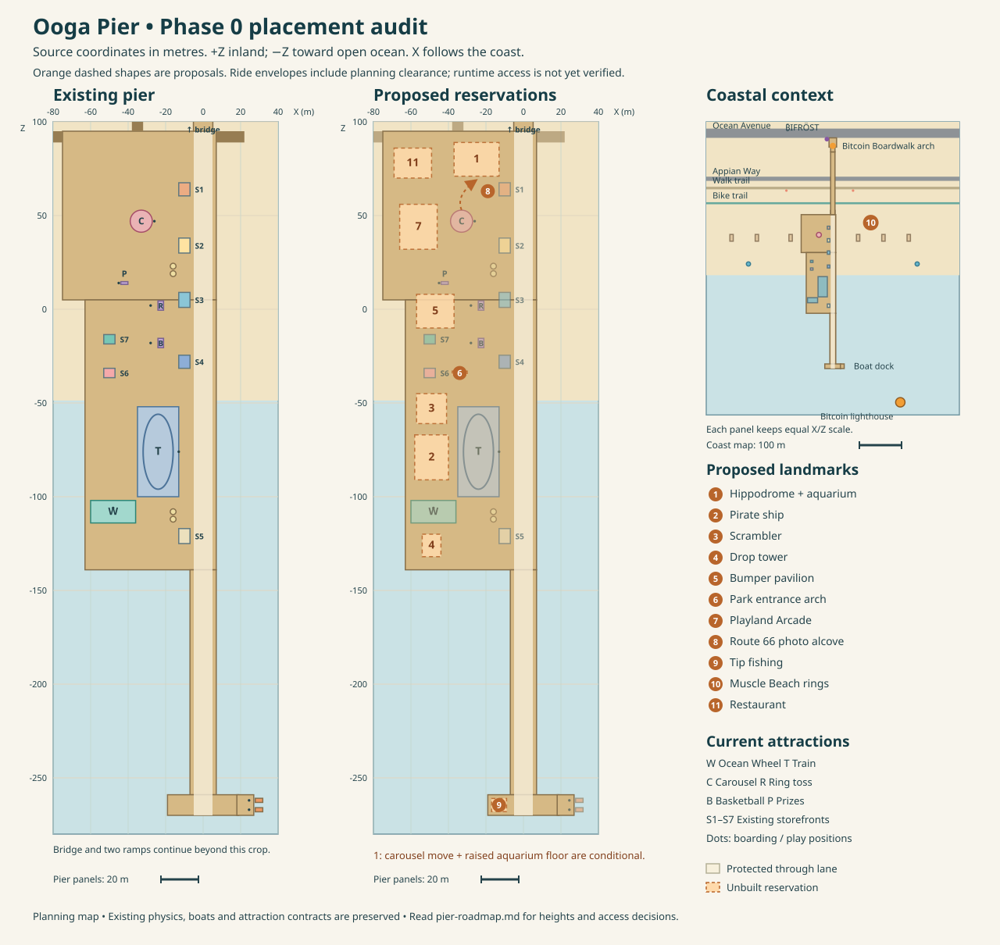

# Ooga Pier roadmap — Phase 0 audit

Prepared 11 October 2026 as the Phase 0 source audit. The inventory and map below describe that pre-build state. Phase 1 was subsequently approved with the raised Hippodrome floor and walkable aquarium; its implementation and access dimensions are recorded in [the survey](ooga-pier-survey.md#phase-1-authored-landmarks).

Source paths in the prompt pack use `js/`; this repository's editable modules are under `src/js/`. The generated single-file page is a build artifact, not the editing target. Existing AGENTS.md and the maintainer's commit policy remain in place.

## 1. Coordinate map and current inventory

One unit represents one metre. +Z leads inland toward Ocean Avenue; -Z leads toward the pier tip and open ocean. X runs along the coast. “West half” below means negative X in this local frame; these axes are not geographic east/north. All rectangles list X range followed by Z range.

The diagram uses source coordinates and equal X/Z scale within each panel. Ride rectangles are conservative planning envelopes, not measured collision meshes. Dashed orange areas are unbuilt reservations. The coastal panel uses a smaller scale. The main data owner is [pier-models.js](../src/js/pier-models.js); some existing placements still live in other modules, as noted below.

### Decks and connections

| LAYOUT entry | Centre X, Z | Width × depth | Extents / height |
|---|---|---|---|
| `decks.arrival` (array id) | -34, 50 | 82 × 90 | X -75…7; Z 5…95; top Y 1.35 |
| `decks.carnival` | -28, -67 | 70 × 144 | X -63…7; Z -139…5; top Y 1.35 |
| `decks.boardwalk` | 0, -199 | 14 × 120 | X -7…7; Z -259…-139; top Y 1.35 |
| `decks.lookout` | 0, -264.5 | 38 × 11 | X -19…19; Z -270…-259; top Y 1.35 |
| `decks.boats` | 22.5, -264.5 | 9 × 11 | X 18…27; Z -270…-259; overlaps lookout by 1 m |
| `bridge` | X 0; starts Z 95 | 10.3632 wide; 148.7424 structural length | Crest Y 12.3228 at Z 202.5765; structural end Z 243.7424; connection continues inland |
| Entrance forecourt | 0, 266 | 18 × 22 | Z 255…277; same upper level as Ocean Avenue |
| `entrance` | 0, 258 | Arch 16.6 wide, 8.5 tall | Base Y 12.3228; neon BITCOIN / BOARDWALK faces both ways |
| `spawn` / `gate` | 0, 284 / -14, 274 | Portal outer radius 2.8 | Ground Y 12.3228; dialer offset (+4, -3) from gate |
| Beach ramps | Rear X -35; west/east at Z 92 | Each 6 wide | Rear Z 95→112; west X -75→-90; east X 7→22; deck 1.35→sand 0.35 |

The deck pieces meet at Z 5, -139 and -259. The rail builder excludes covered edges, so new additions must retain this footprint-union behavior. The fishing continuation is narrow and should stay an open promenade rather than becoming another building row.

### Seven storefronts and café furniture

| Store | Centre X, Z | Width × depth; height above deck | Existing design |
|---|---|---|---|
| Surf Shop | -10, 64 | 6 × 7; 4.6 | Peach, teal shutters/cornice; oval surfboard sign |
| Salt Water | -10, 34 | 6 × 8; 4.4 | Cream, golden balcony; navy/gold scalloped sign |
| Sweet Treats | -10, 5 | 6 × 8; 5.0 | Pale blue, gold pointed windows; rose candy sign |
| Pier Gifts | -10, -28 | 6 × 7; 4.8 | Blue/cream; diamond-ended sign |
| Ocean Café | -10, -121 | 6 × 8; 4.5 | Cream/teal; ivory café plaque |
| Midway Snacks | -50, -34 | 6 × 5; 4.4 | Coral/blue; bulb-bordered marquee |
| Carnival Gifts | -50, -16 | 6 × 5; 4.4 | Turquoise/gold; pennant sign |

All fronts face +X. Awnings project about 1.3 m beyond the façade and sit above head height. Shop-sign node scale is 0.87, exactly three times the former 0.29 scale. Opaque sign boards stand beyond cornices/brackets; the balcony sign stands farther out. Preserve these clearances and the individually approved designs.

Four café sets occupy (-16, 19), (-16, 23), (-16, -112), and (-16, -108). Each canopy has radius 1.55 m and height 2.92 m above its base. White promenade lamps stand at X 6.3, Z -238 through 76 in 35 m increments. Furniture and lamp placements are currently literals in `pier-models.js`, not LAYOUT entries.

### Rides, games and prizes

| Attraction | Centre X, Z | Boarding / play X, Z | Scale and behavior to preserve |
|---|---|---|---|
| Ocean Wheel | -48, -110 | -48, -106 | Radius 10; hub 13.7 above deck; gondolas extend beyond rotor; 48-second ride |
| Nothing Stops This Train | -24, -76 | -13, -76 | Rail centreline 16 × 40; reserve about 22 × 48 including engine; hills about 11 m; continuous 28-second lap |
| Carousel | -33, 47 | -26, 47 | Canopy radius 5.9; roof 6.6 above deck; six horses; 24-second ride |
| Ring toss | -24, 2 | -28, 2 | Five throws; aim→power→flight→result; 10 tickets per hit |
| Basketball | -24, -18 | -28, -18 | Five throws; same state-machine pattern; 8 tickets per basket |
| Tickets and Prizes | -42, 14 | -45, 14 | Counter 3.8 × 1.5; shared Ooga Arcade catalog and saved ownership |

The train's fresh-Space boarding interval is exactly one second per lap. Button clicks and missed presses do not board or queue a ride. New interaction prompts must preserve that contract.

Wheel planning envelope: X -60…-36, Z -114…-102, with its boarding approach extending toward Z -101.5. Train planning envelope: X -35…-13, Z -100…-52; keep additional room around its pad and platform sign. Carousel roof envelope: X -38.9…-27.1, Z 41.1…52.9; its approach extends east to about X -21.5. These are deliberately different from a frame's exact collision surface.

### Beach, boats and lighthouse

| Feature | Current coordinates / extent | Ownership |
|---|---|---|
| Mean wet edge / sand | Wet edge Z about -48.67; dry sand Y 0.35 | `pierBeach.LAYOUT`, continuous `heightAt` |
| Bike / pedestrian trail | Z 122, width 4.8 / Z 158, width 6 | `pier-beach.js`; 600 m explorable coast |
| Appian Way / Ocean Avenue | Z 180, width 10 / Z 288, width 22 | Lower Y 0.41 / upper Y 12.3828 pavement |
| Volleyball | X -240, -180, -100, 60, 120, 180; Z 40 | Six 8 × 16 courts; only net posts collide |
| Ice cream vendors | (-110, 152), (48, 152) | Free cosmetic cone; Space/button; no ticket trade |
| Lifeguard towers | (-200, -22), (200, -22) | Two pale blue towers already exist |
| Kite flyers | X -105, 35, -220, 220; Z -12 | Four animated kites, pooled strings/tails |
| Beach seating | (-140, 15), (140, 15); six bench/bin pairs along Z 152 | Shared café and dressing kit |
| Beach population | 6 cyclists + 12 volleyball players + 4 kite flyers + 2 vendors + 8 walkers = 32 | Anonymous canonical Oogas, six shared cosmetic templates |
| Satoshi / Beacon launches | (29.8, -267), (29.8, -262) | `pierBoats.BERTHS`; 2.2 × 4 DSB hulls; east-facing bows |
| Boat boarding pads | (24.5, -267), (24.5, -262) | `pier-boats.js`; canonical seated/validated dock exits |
| Sailing area | X ±550; Z -800…-65, inset by hull radius | Walking bounds remain X ±300; Z -280…310 |
| Bitcoin lighthouse | (160, -350); sea base Y -0.3 | `pierLighthouse.LAYOUT`; tower about 31 m; protected 10 m footing for boats |

The ocean is `BL.dsbWater.create(...)`, updated once by `pier-life.js`; boats read its FFT through `heightAt`. Keep its mean level, spectrum and canonical movement constants. Current client/Worker pier presence limits are ±900, while the survey document still records the earlier ±320 limit. Correct that documentation in the next approved implementation; no deployment has occurred.

## 2. Patterns and APIs to reuse

| Addition | Existing pattern | Integration contract |
|---|---|---|
| Ride | `pier-rides.js`, `pier-carousel.js`, `pier-coaster.js` | Builder returns `id`, `label`, `root`, fixed `frame`, `seat`, `board`, `seconds`, `pose`/`ridePose`; continuous rides also expose `advance`, `boardOpen`, `untilBoard` and `boardingSeconds`. Register frame with solids and model with the existing ride controller. |
| Boarding / exit | `BL.crew.sitPlayer`, `standPlayer`; ride controller | Seat owns `floor`, `walkAt`, `sitter`, `allowWeapons:false`, `lockMovement:true`; settle canonical gravity before sitting. Carry rider with moving seat, then validate a fixed exit. Preserve equipped jetpack and cancel stale input. No offshore/airborne release. |
| Midway game | `pierGames.build/create` | LAYOUT station, fixed frame/sign, play pad, bounded `near()`, reused projectile/landed nodes, explicit phases and one-shot payout flag. `busy` suppresses movement; `close()` restores pilot/controls; `dispose()` removes listeners. New mechanics get their own bounded controller rather than rewriting ring toss/basketball. |
| Tickets / prizes / best | `BL.game` and `BL.arcadeModels.PRIZES` | Use `addTickets`, `spendTickets`, `redeem`, and supported `recordArcade` keys. New best-score/passport fields need defaults, validated load and save support; arbitrary assignments to state do not survive the current loader. |
| Wayfinding sign | `BL.hubModels.postSign(text, scale, peg)` | Put its solid at the approved LAYOUT position; keep boards and pegs outside through lanes. New glyphs must be validated rather than silently omitted. |
| Coastal façade/sign | `pier-details.js` | Reuse `facade`, `shopDetail`, `shopSign` and the approved palette. Keep closed outward-facing panels and raised lettering in front of all façade structures. |
| Benches, bins, lamps | `BL.dressing.set`, `put`, `cable`, `build`, `nodes` | Use the existing shared kit for set dressing; cache the bake. Only the solid layer collides. String lights must share existing light limits and follow daylight. |
| NPC | `pier-beach.js` anonymous visitor factory pattern | `M.caveman(BL.contributors.traitsFor(...))`; shared templates and owned mutable nodes; hide unused gear. Fixed count, direct transforms, `liveGeometry` for alternate heads, full cleanup. Do not add fake contributors to the registry. |
| Sound | `pier-train-audio.js` | Procedural pooled voices, trusted-gesture unlock, shared saved mute preference, distance attenuation, hidden-page silence, context closed on leave. |
| Physics / scene lifecycle | `scene-pier.js` | Canonical crew/pilot, `solidProps.supportAt`, `segmentClear` and `escapeSegmentClear`; read input before crew, update ride/game afterward, update pilot last. Unregister/dispose/remove roots and null references on leave. |
| Debug camera | Existing pilot `presets` and `goPreset` | Current presets are `overview` and `beach`; there is **no pier `view=` dispatcher yet**. Add a DEBUG-only whitelist to select approved presets after normal arrival; leave production spawn/control unchanged. |

The prompt pack's single-LAYOUT rule is a useful target, but it is not yet the current implementation: beach coordinates, lighthouse position, boat berths, furniture and some scenery are distributed. Put new placement data in `pierModels.LAYOUT`; migrate only existing placement data that a feature actually touches. Keep local model offsets and motion parameters inside feature modules.

## 3. Available space and protected routes

These candidate rectangles come from source inspection. They are planning reservations, not runtime-certified clearance. Decorative reach, rider size, queues, roof overhangs and future ride sweep must be checked before implementing an individual attraction.

| Candidate area | Rectangle | Use / exclusions |
|---|---|---|
| Carnival western middle | X -60…-40; Z -91…-42 | Pirate ship and scrambler; excludes train envelope to the east and the two west shop footprints to the inland side |
| Carnival western oceanward end | X -60…-36; Z -136…-119 | Small drop tower; leave the wheel, its pad and Ocean Café approach clear |
| West park/arrival join | X -60…-36; Z -10…8 | Bumper pavilion; crosses the continuous deck join at Z 5; preserve gift-shop gap and prize queue at Z 12…16 |
| Arrival western middle | X -70…-46; Z 26…58 | Playland building; current carousel lies farther east |
| Arrival inland west | X -70…-46; Z 68…88 | Restaurant and exterior seating; retain west edge and beach-ramp access |
| Arrival inland middle | X -42…-16; Z 71…89 | Hippodrome reservation; same-height scenery fits, but aquarium needs local vertical work |
| West side of lookout | X -17…-9; Z -268…-261 | Fishing props and two fishermen; central lookout and boat access remain open |
| +X beach side | X 78…102; Z 67…85 | Muscle Beach rings; separated from volleyball courts, kite flyers and bike trail |

Protect a clear through route at X -5…5 wherever the pier is broad enough, narrowing to the existing approach's usable width at the bridge. Preserve the 14 m fishing continuation, ocean-side rail views, every existing pad/exit, café furniture and all three ramps. Within new attractions, target 4 m circulation routes and never pinch a navigable gap below 2.3 m. Furniture belongs in alcoves, not in those routes.

The current carousel site is occupied. It becomes additional space only if the proposed relocation is approved and complete. Do not count it as free capacity now.

## 4. Proposed landmark placement

Numbers correspond to dashed reservations in the diagram. Dimensions reserve the complete outer footprint, including future motion where applicable; they are authored gameplay sizes, not newly surveyed real-world measurements.

| No. / proposed LAYOUT key | Centre X, Z | Reservation W × D | Placement decision |
|---|---|---|---|
| 1 `hippodrome` | -25, 80 | 24 × 18 | Inland end of arrival, closer to approach. Relocate existing carousel to this centre with unchanged radius/horses/circuit; proposed upper floor Y 3.65 and boarding at (-18, 80). |
| 1 `aquarium` | -25, 80 | Shares Hippodrome footprint | Beach-level entry Y 0.35, under raised local floor; requires an opening in the current arrival slab and an access route from the sand. |
| 2 `park.ship` | -49, -79 | 18 × 24 | West of the locomotive; swing must remain inside this reservation. Keep at least the planned 6 m separation from the scrambler. Static shell first. |
| 3 `park.scrambler` | -49, -53 | 16 × 16 | West-middle bay; separated from train envelope, ship and snack shop. |
| 4 `park.drop` | -49, -126 | 10 × 12 | Oceanward west pocket; proposed height capped around 22 m, comparable to the wheel silhouette. |
| 5 `park.bumper` | -47, -1 | 20 × 18 | At park/arrival join. Low, open-sided pavilion; leave the prize-counter approach north of it. |
| 6 `park.entrance` | -34, -34 | 8 × 2 | Park threshold inland of the train envelope; leads to circulation between train and western rides. Slender posts, no low crossbar. |
| 7 `playland` | -56, 44 | 20 × 24 | Western arrival bay; main door faces the internal plaza. Exterior shell in Phase 1, interactive cabinets in later approved work. |
| 8 `route66` | -19, 63 | 4 × 4 photo alcove | Beside/behind Surf Shop, outside the through promenade. Face the approach to avoid placing the board behind the storefront. |
| 9 `fishing` | -13, -264.5 | 8 × 7 | Western lookout; rods cast toward -X water. Later Hash Fishing play pad at (-11, -264.5), clear of boat pads. |
| 10 `muscleBeach` | 90, 76 | 24 × 18 | +X shore side, toward the southern beach in the reference interpretation; rings and bars stay clear of trails/courts. |
| 11 `restaurants` | -59, 78 | 20 × 16 | Western inland arrival corner; retain existing seven shops and expand dining with their coastal colors and low roofline. |

### Hippodrome and aquarium: decision required before Phase 1

The current arrival slab is 0.4 m thick: top Y 1.35, underside Y 0.95. Sand below is Y 0.35, leaving **0.60 m** of clearance. A walkable aquarium cannot fit there.

Recommended full version: move the existing carousel intact to (-25, 80), raise only this landmark's floor to Y 3.65, and cut the slab within its aquarium footprint. With a 0.4 m upper floor, the aquarium gets 2.90 m of clear height. Add a 3 m-wide stair and landings on the east side around X -11, Z 76…84, with risers below the canonical 0.6 m step limit. The canopy remains 6.6 m above its own floor; the building roof must clear it. This requires per-ride floor data, layered support and closed wall/floor shells. It does not require changing gravity, body size, jump or step constants.

Lower-risk alternative: enclose the existing carousel in place at (-33, 47), keep floor Y 1.35, and reserve the aquarium for a separate later structural phase. That preserves current boarding but does not achieve the requested approach-end location or a genuinely usable aquarium beneath it. Do not draw a person-sized doorway beneath the existing solid slab as a substitute.

### Photo sign, fishermen and backdrop

Route 66 copy requested: “END OF THE TRAIL · 21,000,000 · 2140”. Treat 2140 as an approximate issuance-era reference in the optional explanation, not a guaranteed calendar date. Verify facts before adding the educational copy. The current sign glyph table must be checked for the middle dot; use a geometric separator if missing. Fit the text to the approved alcove, likely as several readable sign boards rather than a long marquee over the promenade.

Put two fishing NPCs near (-15, -266.5) and (-15, -263). Keep the existing 32-person decor cap by repurposing two of the eight promenade walkers, rather than silently adding another population. Use shared anonymous body templates and pooled rod/line animation in a later approved task.

Existing palms already line Z 150, 193 and 310. Reuse and extend those batches for the Palisades-inspired bluff backdrop, behind Ocean Avenue and its sidewalks. Current `pier-life.js` has a generic ridge near Z 700; it is not a geographic mountain reconstruction. In Phase 1, place distinct north/south coastal ridge bands beyond the ±300 m walking boundary and a low offshore island silhouette beyond the boat area. Store them in `LAYOUT.backdrop`. Final orientations/contours require a reference pass before labeling them Santa Monica Mountains, Palos Verdes and Catalina; do not turn the approximate world axes into invented survey coordinates. Keep their low silhouettes clear of the lighthouse's seaward beam and the sunset.

## 5. Files and sequence for the next approved phase

1. **Placement and cameras:** add reviewed entries in `src/js/pier-models.js`, a small debug camera table and `view=` selection in `src/js/scene-pier.js`, and update `docs/ooga-pier-survey.md` with authored sizes/confidence. Move only touched placement literals into LAYOUT.
2. **Static western park:** one `pier-park.js` builder with cached/merged geometry for four ride placeholders and the entrance; register fixed solids. No ticket rounds, boarding controllers or new NPCs yet.
3. **Arrival landmarks:** one `pier-landmarks.js` builder for Playland, restaurant, Route 66 and Hippodrome/aquarium exterior. If the raised version is approved, change `pier-carousel.js` and its LAYOUT floor/board data only as required; keep the shared ride controller and circuit.
4. **Dressing, coast and tip:** shared kit for benches/bins/string lights; reuse existing lifeguard towers/pilings rather than duplicate them; add the reviewed fishing/gym/backdrop placements with bounded anonymous NPCs.
5. **Verification:** after implementation, inspect the new debug cameras, walk entrances/queues/stairs/underpasses, test the relocated carousel and boats, compare sunset/night and Canvas, and measure frame time on WebGL tiers. The 60 fps budget is a target; this source audit does not establish current or future fps.

Approved camera presets: `pier-park` target (-39, 1.35, -67), distance 115; `pier-hippodrome` target (-25, 3.65, 80), distance 60; `pier-tip` target (0, 1.35, -264.5), distance 70. Phase 1 implements these review URLs, plus `view=pier-aquarium` for the lower room:

- `http://127.0.0.1:8081/oogapier?debug=1&view=pier-park&hour=18.8&day=172&nosim=1`
- `http://127.0.0.1:8081/oogapier?debug=1&view=pier-hippodrome&hour=18.8&day=172&nosim=1`
- `http://127.0.0.1:8081/oogapier?debug=1&view=pier-tip&hour=22&day=172&nosim=1`

## 6. Dependencies for later phases and review gates

- **Interaction layer:** wrap existing controllers instead of creating another boarding/payout system. The proposed E shortcut conflicts with the pilot's Q/E camera controls; consume it only for a nearby eligible action. Keep the train's one-second fresh-Space rule, existing Space game controls, native focused-button activation and dock-only boat exits.
- **Passport/minimap:** phase-specific saved-state schema and validation are required. Declare ten stable landmark ids before implementing stamps; no new real-money payouts.
- **Bitcoin facts:** one reviewed table, one concept per attraction, short copy and optional detail. The supplied game lessons are proposals; verify protocol claims against primary sources during the relevant implementation.
- **Live world:** inspect the existing `BL.chain`/`BL.mempool` feeds before approving an additional poller. Confirm whether “mempool tide” should be cosmetic or may change wave amplitude; the current accepted requirement preserves DSB water physics.
- **Performance:** merge by cullable venue/sector, share cached meshes, cap actors and effect pools, reuse hot-loop scratch and existing light budgets. Do not merge the entire pier into an uncullable mesh or add a second ocean FFT.
- **Validation:** the Phase 0 audit itself ran no runtime checks. Subsequent approved work verified boats, all three original rides, prize redemption and the Phase 2 interaction layer; see the survey's phase-specific verification records. Prize-counter affordability and one-redemption checks now pass.

Phase 1 approval selected the raised Hippodrome/aquarium version. The upper stairs run along Z 86, separate from the lower entrance ramp at Z 76. Phase 2 was subsequently approved and implemented: contextual E/tap prompts, a foldable map, ten saved Passport stamps with a free medallion, and two talkable existing vendors. Its registry wraps existing controllers and keeps the locomotive's one-second fresh-Space rule. Later phases still require approval.

## Phase 3 progress — Hash Fishing

“Proceed to the next” approved the first game in the supplied one-game-at-a-time sequence. Hash Fishing now uses the western tip's reserved pad at (-11, -264.5), facing -X water. Its side sign stands at (-16.8, -261.4), outside the casting camera's view of the bobber. The existing two fishermen, central promenade, east-side boat pads and pier footprint remain in place.

E, Space or the shared tap prompt opens the lesson. Start begins a free 75-second round; each fresh Space or Cast tap samples one 32-bit random hash, with 1.6 seconds of casting and 0.9 seconds of reeling before another cast. A hash at or below the sampled target catches a fish worth five tickets. Every three catches, the target adjusts toward an eight-second average catch pace. This illustrates the target concept and is not Bitcoin mining; the optional primary-source explanation distinguishes the game's timing from the protocol.

Tickets bank once at the completed deadline. Leaving early discards pending tickets. The best ticket score saves as `pier.fishing`, with a bounded maximum of 150 and validation that retains older Passport saves. Pooled tackle, three visible basket fish, bounded splash particles and three synthesized sound voices provide feedback. The bobber reads the existing DSB ocean surface; character scale, gravity, movement and water spectrum are unchanged. The train retains its one-second fresh-Space boarding rule.

The locked casting camera shows the rail and water. The phone card moves below the casting area during play; inactive navigation, walking hints and sticks return immediately on exit. The debug review camera is `view=pier-fishing`. Verification and local evidence are recorded in [the survey](ooga-pier-survey.md#hash-fishing--phase-3).

Hash Fishing completed the first game in the supplied sequence. The subsequent “Proceed” approved Block Builder below.

## Phase 3 progress — Block Builder

Block Builder now occupies open sand at (32, 76), with its grounded play pad at (32, 81), Y 0.35. The low teal table is 4.2 m square; its sign stands at (28.8, 74.5). The 7 × 11 m reservation stays outside the beach ramps, volleyball courts, Muscle Beach and both trails. All new placement data lives in `LAYOUT.builder`.

The free 75-second round packs three offered transactions into a 6 × 6 block. Six two-to-four-space shapes can rotate; their invented fee rates range from one to six fees per unit. Choose an offer, position it and place it without crossing the block edge or overlapping another transaction. New offer replaces the selected choice without adding fees. Higher fees in the available space improve the result. Keyboard uses 1–3, arrows/WASD, R, X and Space; touch uses offer buttons, grid cells, Rotate, New offer and Place.

Every four collected game fees produce one ticket at the deadline, up to 54 tickets from 216 fees. Pending tickets are discarded on early exit. A validated, improving best saves as `pier.builder`, retaining older Passport and fishing progress. The lesson returns at the result; optional detail explains the toy grid and links to the actual block-weight rule. Primary references: [BIP 141](https://github.com/bitcoin/bips/blob/master/bip-0141.mediawiki#block-size) and the [Bitcoin mining guide](https://developer.bitcoin.org/devguide/mining.html).

Thirty-six reusable table blocks, four preview blocks, bounded placement particles and three synthesized audio voices supply feedback. The camera and controls return to the same Ooga after Escape or Back to beach. Touch sound unlocks on a completed tap recognized by browser user activation. The debug camera is `view=pier-builder`. Verification and review evidence are recorded in [the survey](ooga-pier-survey.md#block-builder--phase-3).

The subsequent approval to proceed and continue QA selected Mempool Mayhem below.

## Phase 3 progress — Mempool Mayhem

The bumper-car pavilion at (-47, -1) now hosts a free 75-second fee-market round. Its original 20 × 18 m floor, striped roof and posts stay in place; the roof hides only while playing so the overhead driving camera can see the cars. The exterior boarding/exit pad is (-34.5, -1), Y 1.35, outside the arena and adjacent walking lane. Placement data and the `view=pier-mayhem` review camera live in `LAYOUT`.

Drive the orange car with WASD/arrows or the phone's left stick. Three orange fee tokens each add two fees, up to nine. Six equal-size cars compete for one gate admission every ten seconds; only cars past the yellow queue line are eligible. The highest fee wins, with earlier queue arrival breaking ties. Bumper contacts rebound and the existing pavilion rails contain the bounded car simulation. Space or the Brake button slows the car. Each admission earns six pending tickets; the completed deadline banks once, up to 42 tickets, and saves an improving `pier.mayhem` best. Early exit discards pending tickets.

The lesson and optional detail distinguish the toy equal-size cars and ten-second slots from actual Bitcoin block assembly. The source is [Bitcoin Core's miner implementation](https://github.com/bitcoin/bitcoin/blob/master/src/node/miner.cpp), which also considers transaction dependencies and other validity/space constraints. This game adds no chain feed or payment code.

All car, fee-badge, token and spark geometry is cached before play. Six cars, three reusable tokens, four contact sparks and three synthesized audio voices keep effects bounded. The existing seated-player system carries the same Ooga in the car and validates a safe exit at the exterior pad. The result restores the lesson; Escape or Back to pier restores walking, navigation, sticks and the roof. The train's one-second fresh-Space boarding rule and DSB's character scale, walking physics and shared ocean remain unchanged. Verification and visual evidence are recorded in [the survey](ooga-pier-survey.md#mempool-mayhem--phase-3).

The subsequent “Proceed” approved Double-Spend Whack below.

## Phase 3 progress — Double-Spend Whack

Playland's porch now has a low teal and orange transaction-whacking cabinet at (-44.2, 44), with its play/exit pad at (-40.8, 44), deck Y 1.35. Its 3.65 × 2.65 m body stays beside the building, below the awning. The adjacent walking lanes, central promenade and ocean frontage remain open. Placement and the `view=pier-whack` camera live in `LAYOUT.whack`.

The free 75-second round has thirty 2.5-second waves. Each independent toy ledger identifies three spent outputs, A–F. Three pop-up transactions include at least one repeat spend and one unspent input. Compare their letters to the ledger: reject repeat spends for two points, leave valid inputs alone, lose two points for a wrong hit or one for a missed rejection. Each target resolves once. Arrows/WASD or 1–9 select a slot; fresh Space whacks it. Tapping a slot whacks directly, and native focused buttons retain Space activation.

The deadline banks one ticket per three points, up to 40, and saves an improving whole-point best as `pier.whack`, bounded at 120. Early exit discards pending tickets. Older saves retain the Passport and prior games. The intro and result state the one-spend lesson; optional copy explains independent toy snapshots and links to the [Bitcoin developer guide](https://developer.bitcoin.org/devguide/block_chain.html#introduction).

Nine pooled letter targets, a selection ring, a striking mallet, bounded sparks and three synthesized sound voices provide feedback. The shared pier mute controls the audio. Inactive equipment controls hide during the game and restore on exit, keeping the phone's mute button clear; the phone card sits below the full toolbar. The same upright Ooga stays on the pad and resumes walking after Escape or Back to pier; departure disposes owned listeners, UI and audio. DSB's metre scale, movement and shared ocean physics remain intact, as does the train's one-second fresh-Space boarding window. Verification and visual evidence are recorded in [the survey](ooga-pier-survey.md#double-spend-whack--phase-3).

The subsequent “continue” approved Seed Phrase Match below.

## Phase 3 progress — Seed Phrase Match

Playland's porch now has a teal and brass card table at (-43.45, 53), with its play/exit pad at (-40.8, 53), deck Y 1.35. It sits nine metres along the frontage from Double-Spend Whack, below the awning and forward of the windows. Placement and the `view=pier-seed-match` review camera live in `LAYOUT.seedMatch`.

The free 75-second round shows twelve numbered public game words for 12 seconds, then shuffles their positions. Pick two cards to swap them back into the memorized order. Arrows/WASD select and fresh Space picks or swaps; C or Check order reports the number of correct positions. Touch swaps with two taps. A perfect order locks editing until the deadline. The completed round awards two tickets per correct position plus six for a perfect order, up to 30, and saves an improving whole-word best as `pier.seedMatch`, bounded at 12. Leaving early discards pending tickets, including a secured perfect order.

The intro and result teach an ordered, private backup, with optional detail and a [BIP 39 reference](https://github.com/bitcoin/bips/blob/master/bip-0039.mediawiki). The fixed pier words are deliberately public toy cards. The game accepts no recovery-word input, generates no wallet and saves only the best count and shared tickets. Older saves keep all prior games and Passport progress.

Twelve pooled card meshes, a selection ring, a short lift on pick/swap, bounded result sparks and three synthesized audio voices supply feedback. The shared pier mute applies. Inactive walking and equipment controls hide during play, the phone card clears the wrapped toolbar, and Escape or Back returns the same upright Ooga to the pad. Departure removes owned listeners, UI and audio. DSB's scale, body and ocean physics, clear walking lanes and the train's one-second fresh-Space rule remain in place. Verification and evidence are recorded in [the survey](ooga-pier-survey.md#seed-phrase-match--phase-3).

The subsequent approval selected Lightning Volley below.

## Phase 3 progress — Lightning Volley

The existing 8 × 16 m beach court at (60, 40), sand Y 0.35, now hosts Lightning Volley. Its grounded play/exit pad is (60, 30); the shared scene keeps the court's two anonymous NPCs and the 32-person beach cap. Other courts, trails, ramps and the sea remain open. Placement and the `view=pier-volley` review camera live in `LAYOUT.volley`.

The free 75-second round contains fifteen five-second rallies. Route a ball carrying one to three toy units through teammate A, B, or both, then to the far target. Each directed channel displays its current capacity; insufficient links and revisited teammates refuse a pass. Every rally has a usable route, and Restart returns to Serve while its timer continues. Arrows/WASD or 1–3 select a receiver; fresh Space passes and X restarts. Touch taps a receiver directly. Each delivery earns four pending carnival tickets, with a maximum of sixty banked once at the completed deadline. Early exit discards pending rewards. A validated, improving whole-delivery best saves as `pier.volley`, bounded at fifteen, retaining all earlier games and Passport progress.

The intro and result teach Lightning channel routing, with optional detail and a [BOLT 4 reference](https://github.com/lightning/bolts/blob/master/04-onion-routing.md). The visible toy capacities and sequential passes simplify conditional transfers, hidden balances, fees and time limits. No payment, wallet or network code is added.

The existing ball and court players supply the animation; four reusable rings, six channel paths, bounded delivery sparks and three procedural audio voices provide feedback. The shared pier mute applies. The phone play card sits below the court, and readable ground letters identify the receivers. Escape or Back restores the same upright Ooga at the sand pad with walking, navigation and equipment. Departure removes owned UI/listeners and closes audio. DSB's metre scale, body movement, shared FFT ocean and the train's one-second fresh-Space boarding rule remain intact. Verification and evidence are recorded in [the survey](ooga-pier-survey.md#lightning-volley--phase-3).

**Next proposed game:** Proof-of-Work Gym at Muscle Beach. Remaining Phase 3 work and Phase 4 live data still need subsequent approval.
